# WebLab7

## Nama: Fahrul Rahman

## Nim: 312510088

## Teknik Informatika

### 1. Tujuan Praktikum

Praktikum ini bertujuan untuk mempelajari dasar-dasar pemrograman server-side menggunakan bahasa PHP.

Tujuan yang ingin dicapai:

- Memahami perbedaan pemrosesan client-side dan server-side.
- Mengenal sintaks dasar PHP dan cara menjalankannya melalui server lokal.
- Memahami penggunaan variabel, tipe data, operator, percabangan, perulangan, dan function.
- Memahami pemrosesan form menggunakan metode GET dan POST.
- Melakukan validasi dan sanitasi input pengguna.
- Membuat aplikasi sederhana untuk menerima, memproses, dan menampilkan data mahasiswa.

### 2. Perangkat yang Digunakan

Perangkat lunak dan perangkat keras yang digunakan dalam praktikum ini:

1. Laptop atau PC.
2. Visual Studio Code sebagai editor kode program.
3. XAMPP sebagai server lokal.
4. PHP sebagai bahasa pemrograman server-side.
5. Apache sebagai web server.
6. Google Chrome sebagai web browser.

### 3. Cara Menjalankan Server Lokal

Berikut langkah-langkah menjalankan program PHP menggunakan XAMPP:

1. Pastikan aplikasi XAMPP sudah terinstal di komputer.
2. Buka aplikasi XAMPP Control Panel.
3. Klik tombol **Start** pada bagian Apache.
4. Pastikan Apache berjalan dengan status aktif.
5. Buka folder instalasi XAMPP, kemudian masuk ke folder htdocs
6. Buat folder proyek dengan nama WebLab7.
7. Simpan seluruh file PHP ke dalam folder tersebut.
8. Buka folder proyek menggunakan Visual Studio Code.
9. Buka browser Google Chrome.
10. Masukkan alamat berikut:

http://localhost/WebLab7/WebLab7/

11. Tekan Enter untuk menjalankan program.
12. Pilih halaman latihan atau mini project yang ingin diuji.

**Catatan:** File PHP harus dijalankan melalui server lokal menggunakan localhost, bukan dengan membuka file secara langsung melalui browser.

## 4. Struktur File

Struktur folder proyek Praktikum 7:

- WebLab7
- index.php
- mini_project.php
- Eksperimen
- README.md

## 5. Ringkasan Hasil Praktikum

Berdasarkan kegiatan Praktikum 7, beberapa program berhasil dibuat dan dipelajari, yaitu:

1. **Menjalankan PHP:** Menampilkan teks dan waktu server melalui browser.
2. **Variabel dan Percabangan:** Menghitung nilai akhir mahasiswa berdasarkan nilai tugas, UTS, dan UAS serta menentukan predikat.
3. **Perulangan dan Array:** Menampilkan daftar nama mahasiswa menggunakan perulangan foreach.
4. **Function:** Membuat fungsi untuk menghitung diskon dan menghasilkan harga setelah diskon.
5. **Form GET:** Menerima kata kunci dari pengguna dan menampilkannya melalui parameter URL.
6. **Form POST:** Menerima nama dan program studi kemudian menampilkan data yang dikirimkan.
7. **Pengolahan Data:** Menghitung subtotal harga barang berdasarkan harga dan jumlah barang.
8. **Mini Project:** Membuat aplikasi formulir data mahasiswa yang menerima nama, NIM, program studi, semester, dan email.

### Pengujian Input

**A. Input Valid**

1. Form mahasiswa diisi dengan nama, NIM, program studi, semester 3, dan email dengan format yang benar.
2. Form barang diisi dengan nama barang, harga 150000, dan jumlah 2.

Hasil: Program dapat memproses data dan menampilkan hasil sesuai input.

**B. Input Tidak Valid**

1. Form mahasiswa dikirim tanpa mengisi nama atau NIM.
2. Form mahasiswa diisi dengan format email yang salah atau semester di luar rentang 1–14.

Hasil: Program menampilkan pesan kesalahan dan tidak menampilkan ringkasan data yang belum valid.

#### Pertanyaan Evaluasi

1.  Apa perbedaan pemrosesan client-side dan server-side?

Client-side adalah proses pengolahan data yang dilakukan di sisi pengguna melalui browser. Contohnya menggunakan HTML, CSS, dan JavaScript.
Server-side adalah proses pengolahan data yang dilakukan di server. Contohnya menggunakan PHP untuk memproses formulir, mengolah data, dan berkomunikasi dengan database.

2. Mengapa file PHP harus dijalankan melalui web server?

Karena PHP merupakan bahasa pemrograman server-side yang membutuhkan web server untuk menjalankan dan memproses kode PHP. Contohnya menggunakan Apache melalui XAMPP. Hasil pemrosesan PHP kemudian dikirimkan ke browser dalam bentuk HTML.

3. Apa fungsi tanda $ pada variabel PHP?

Tanda $ digunakan untuk mendeklarasikan atau menandai sebuah variabel dalam PHP. Contohnya:
$nama = "Fahrul";
$umur = 19;

echo $nama;
echo $umur;

4. Apa perbedaan metode GET dan POST?

- GET: Mengirimkan data melalui URL sehingga data dapat terlihat pada alamat browser. Biasanya digunakan untuk pencarian atau mengambil data.
- POST: Mengirimkan data melalui bagian body HTTP sehingga data tidak ditampilkan langsung pada URL. Biasanya digunakan untuk mengirim formulir atau menyimpan data.

5. Mengapa input pengguna perlu divalidasi di sisi server?

Karena validasi server-side bertujuan memastikan data yang dikirim pengguna sesuai dengan ketentuan program. Validasi ini juga membantu mencegah data kosong, format yang salah, dan input yang tidak sesuai sehingga keamanan serta keakuratan data lebih terjaga.

6. Apa fungsi htmlspecialchars() ketika menampilkan data dari form?

Fungsi htmlspecialchars() digunakan untuk mengubah karakter khusus HTML menjadi bentuk yang aman sehingga tidak dianggap sebagai kode HTML atau JavaScript oleh browser. Fungsi ini membantu mencegah serangan XSS (Cross-Site Scripting).

Contoh:
$nama = htmlspecialchars($\_POST["nama"]);
echo $nama;

7. Apa manfaat penggunaan function dalam program PHP?

Function bermanfaat untuk membuat kode program lebih terstruktur, mengurangi pengulangan kode, mempermudah pemeliharaan, dan membuat program lebih mudah dipahami. Function juga memungkinkan suatu kode digunakan kembali dengan cara memanggil nama fungsi tersebut.

###### Hasil Gambar Dari Index.Php

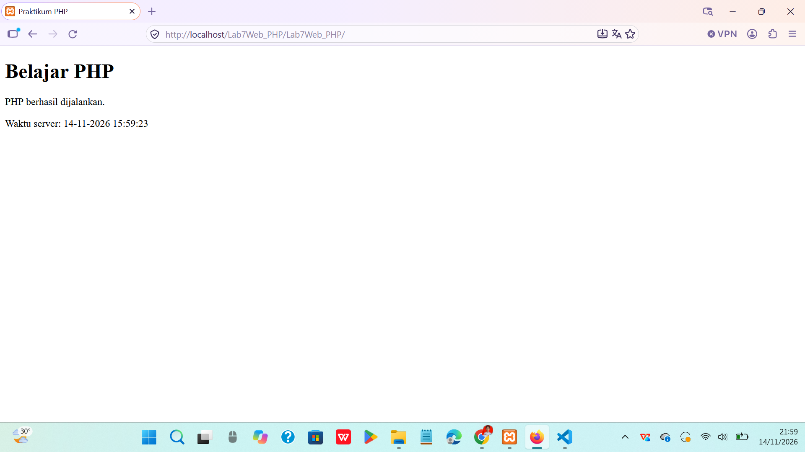

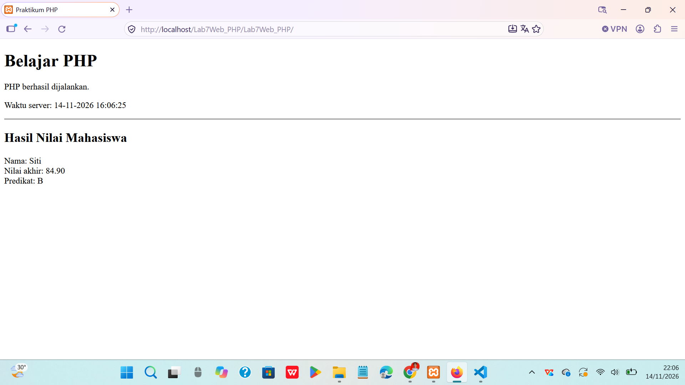

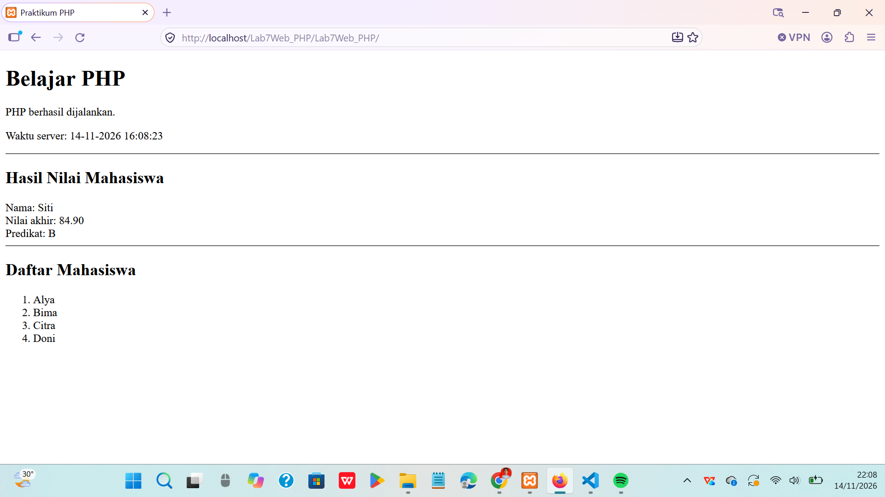

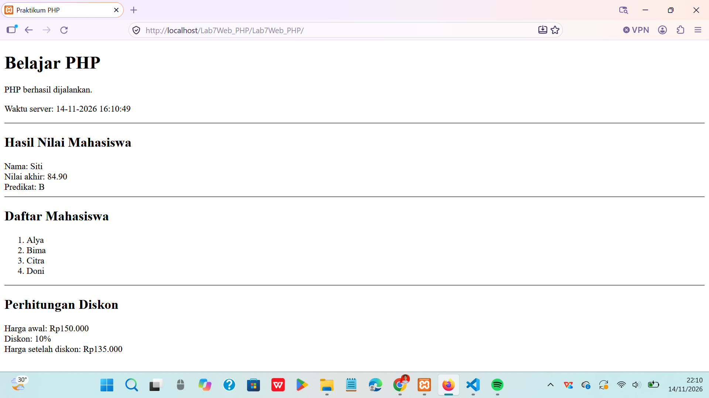

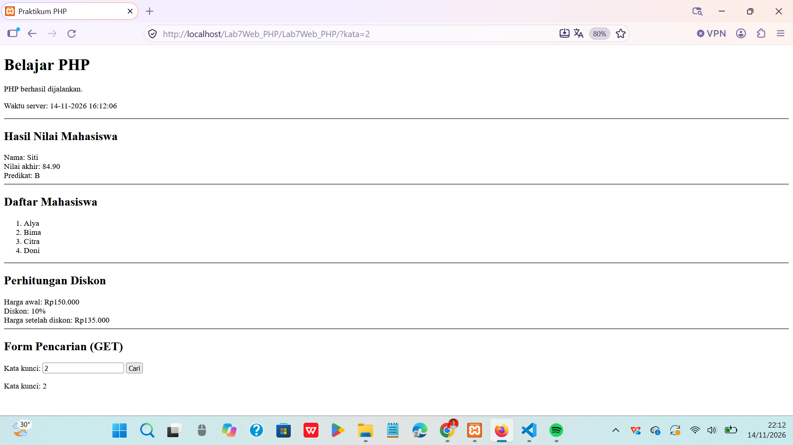

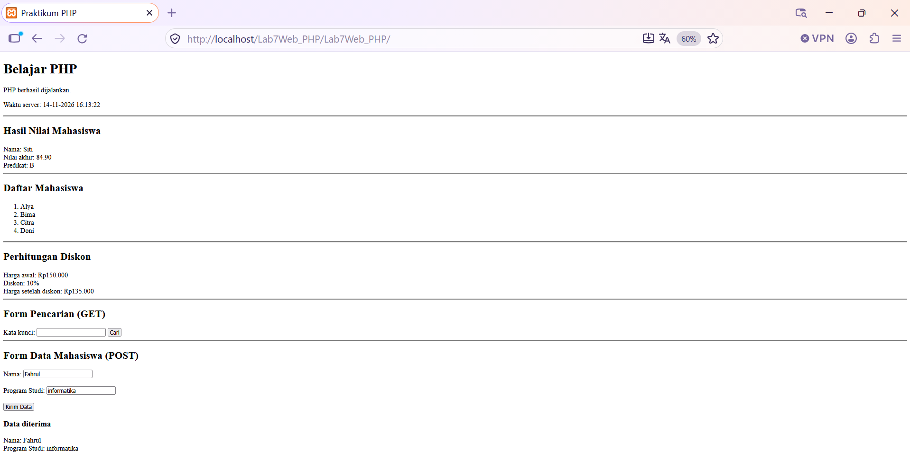

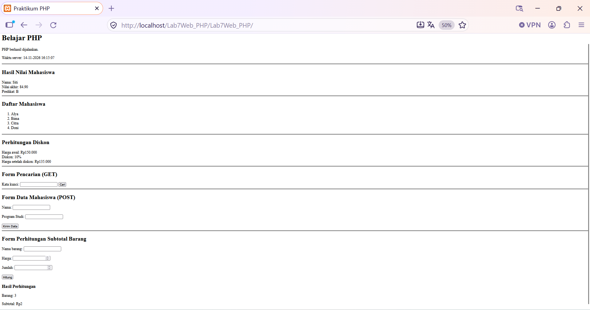

###### Hasil Gambar Dari Eksperimen

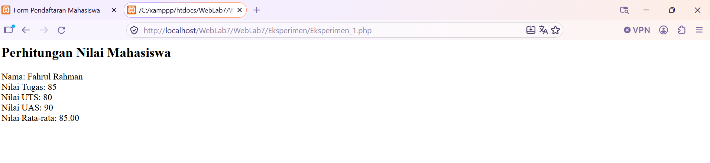

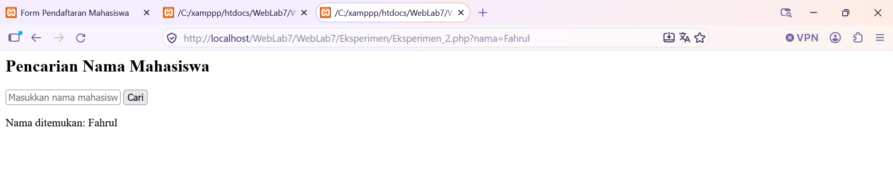

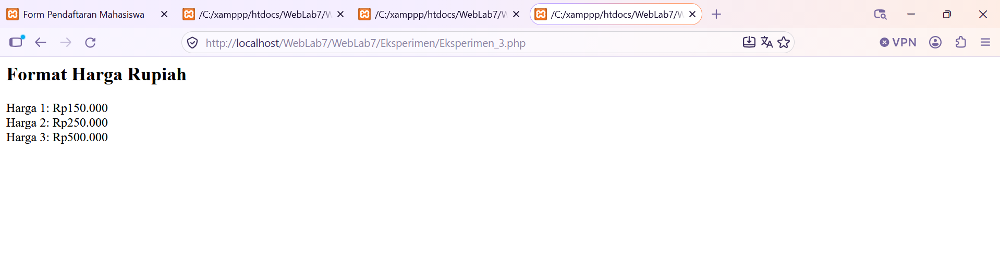

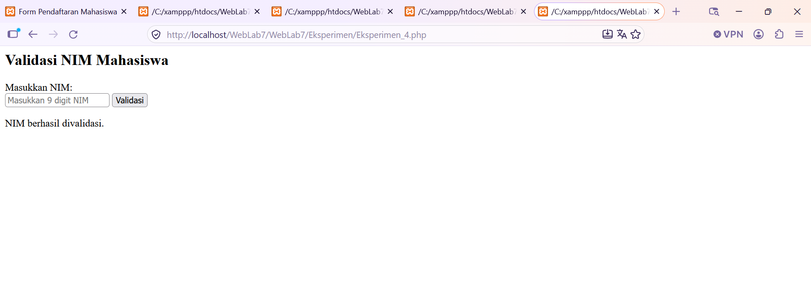

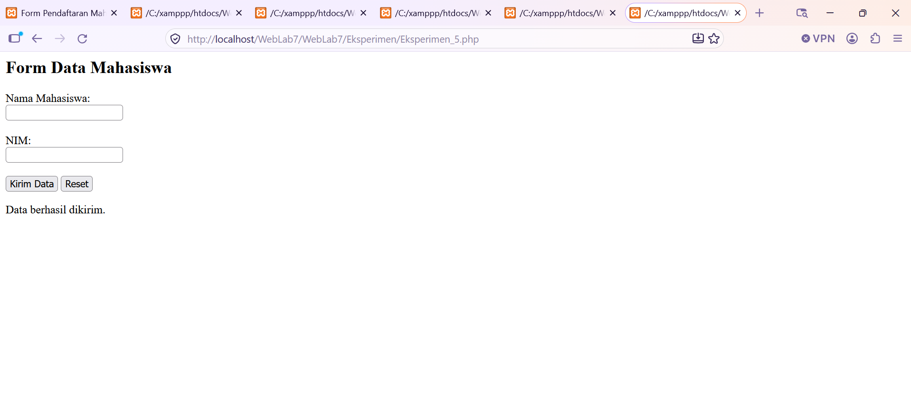

###### Hasil Gambar dari Mini Project

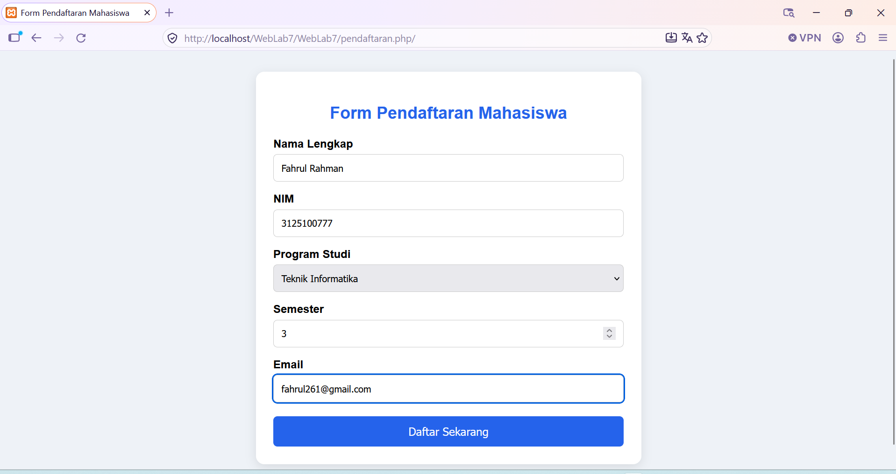
